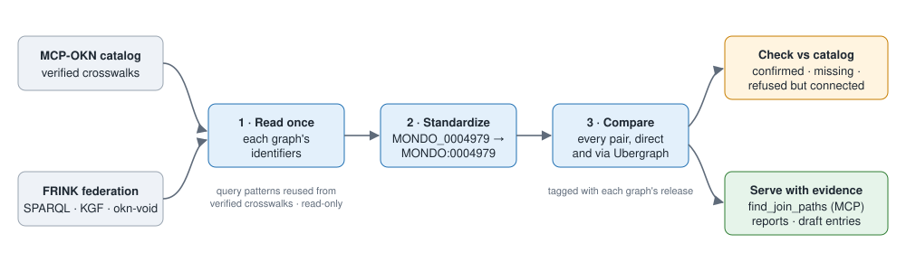

# okn-connection-map

[](https://github.com/frink-okn/okn-connection-map/actions/workflows/ci.yml)
[](https://frink-okn.github.io/okn-connection-map/)
[](https://github.com/frink-okn/okn-connection-map/blob/master/LICENSE)
[](https://github.com/frink-okn/okn-connection-map/blob/master/pyproject.toml)
[](https://github.com/frink-okn/okn-connection-map/releases/tag/v0.2.0)

**Find out where the Proto-OKN knowledge graphs connect: computed from the data, with evidence, and served to AI agents.**

**Live demo (no install needed): https://frink-okn.github.io/okn-connection-map/** — the report, explorer, and join-path demo from the 15 October 2026 sample run. Enable it once in Settings > Pages > Source: GitHub Actions, then push.

`okn-connection-map` reads the identifiers each graph in the [Proto-OKN](https://www.proto-okn.net/) / FRINK federation actually holds. Examples are disease codes, gene IDs, chemical numbers, ZIP codes and county codes. It then works out which graphs share them, either directly or through a mapping graph such as Ubergraph. The result is checked against the hand-curated crosswalk catalog that [MCP-OKN](https://github.com/sbl-sdsc/mcp-okn) uses to tell AI agents which graphs can be joined. Every connection comes with evidence you can re-check against the live federation. The same answers are available to any AI agent through a small MCP tool, `find_join_paths`.

The tool only reads from OKN services and never changes them. It needs nothing but Python, with no extra packages, and it runs on Windows, macOS and Linux.

> **Status:** research prototype (v0.2), shared with the OKN team for review. We'd welcome feedback on whether it should become part of MCP-OKN, and how. See [Proposed integration with MCP-OKN](#proposed-integration-with-mcp-okn).

---

## Contents

- [The idea in one minute](#the-idea-in-one-minute)
- [What we found](#what-we-found)
- [Try it in 10 minutes](#try-it-in-10-minutes)
- [Compute your own map](#compute-your-own-map)
- [Use it with an AI agent (MCP)](#use-it-with-an-ai-agent-mcp)
- [Proposed integration with MCP-OKN](#proposed-integration-with-mcp-okn)
- [How the results are checked](#how-the-results-are-checked)
- [What is in this repository](#what-is-in-this-repository)
- [Documentation](#documentation)
- [Limits](#limits)
- [Citing, license, contact](#citing-license-contact)

---

## The idea in one minute

**Why joins matter.** The OKN graphs are built by different teams. Each is useful on its own, but the federation's real value is answering questions that span graphs. For example: *which datasets in NDE study the rare diseases described in rdkg?* or *which court records in SCALES come from the rural counties described in RuralKG?* Every such question needs a **join**: an identifier that both graphs use for the same thing, such as the same disease code or the same county code.

**How agents find joins today.** When an AI agent works through MCP-OKN, it calls `get_join_strategy(graph_a, graph_b)` before joining two graphs. The answer comes from a hand-curated **crosswalk catalog**, where a crosswalk is a stored, verified join rule for one pair of graphs. The tool gives one of three answers:

| Answer | Meaning for the agent |
|---|---|
| `verified` | use the stored crosswalk |
| `unknown` | nothing stored; try to discover a join yourself |
| `known_non_join` | "this pair was checked and does not join: **do not retry**" |

**The gap.** Checking pairs by hand is slow: about 45 graphs make 990 pairs, and graphs change with every release. In the current catalog, **327 of the 341 "do not retry" answers rest on a note about a single graph**, for example "rdkg's variant IDs have no partner", not on a check of the pair itself. When such an answer is wrong, the agent stops and the user never learns that an answer existed.

**What this tool does.** It computes the connections instead of curating them:

1. It reads each graph's identifiers once, reusing the query patterns that already work in the catalog's verified crosswalks.
2. It puts different spellings of the same identifier into one standard form, so that `http://purl.obolibrary.org/obo/MONDO_0005015` and `MONDO:0005015` match.
3. It compares every pair of graphs, directly and through mapping graphs (Ubergraph, Wikidata).
4. It records which release of each graph was measured, so the map can be refreshed per release.
5. It returns, for any pair: what MCP-OKN answers today, every route the data support, sample shared identifiers with their names in both graphs, and small queries that re-check them live.



---

## What we found

From the run of 15 October 2026, included in [`sample_results/2026-10-15c`](sample_results/2026-10-15c):
- 34 graphs profiled, using 184 per-graph patterns taken from 164 of the catalog's 193 crosswalk queries;
- 424 requests, 319 MB, 102 minutes.

| Finding | Number |
|---|---|
| Stored crosswalks the map reproduces (of those it could test) | **117 of 122** |
| Where the catalog records a count: the map's count is within 5% | **76 of 85** (62 exact) |
| Pairs of graphs that share identifiers | **139** (plus 23 that share only names) |
| Connected pairs the catalog did not answer | **40**: 24 answered "unknown", 16 refused with "do not retry" |
| Pairs where a mapping graph (Ubergraph, Wikidata) reaches entities a direct join misses | **83** |
| Live re-check, 11 Nov 2026, three example pairs: sampled identifiers found in both graphs | **34 of 34** |

**Follow-up against the catalog of 9 November 2026** (`ocm followup`): the maintainers have since added **10 of the 40** connections. **8 have exactly the count this tool computed**; for example, NDE × rdkg went in at 2,907 shared diseases. We read this as independent confirmation of the method. The other **30 are still missing**, and 13 of them are still refused. Examples:

| Pair | MCP-OKN today | What the data show | Evidence |
|---|---|---|---|
| GeoConnex × RuralKG | `known_non_join`, based on a note about GeoConnex's S2 cells | **3,222 shared US counties** (FIPS codes) | [`examples/queries/03_…rq`](examples/queries/03_geoconnex_ruralkg_shared_counties.rq) |
| AOP-Wiki × ICE | `unknown` (the catalog stores 339 for this pair inside entry E3, but the tool does not return it) | **339 shared chemicals** (CAS) and 171 shared genes | [`examples/queries/04_…rq`](examples/queries/04_aopwiki_ice_shared_chemicals.rq) |
| RuralKG × SUDOKN | `known_non_join` | **4,032 shared ZIP codes** | `ocm paths ruralkg sudokn` |
| NDE × rdkg | was `known_non_join`; **`verified` since 14 Oct** (A32, 2,907) | 2,907 diseases + 251 phenotypes, +451 through Ubergraph | [`examples/queries/02_…rq`](examples/queries/02_nde_rdkg_shared_diseases.rq) |

The catalog is mostly right. The case for computing the map is speed, evidence and freshness. It finds these joins weeks earlier, shows why each one holds, and re-checks every pair at every release.

---

## Try it in 10 minutes

No programming experience is needed: copy each block into a terminal. On Windows, use **Anaconda Prompt** or **Command Prompt**; on macOS, **Terminal**. Slower, step-by-step help: [docs/02_installation.md](docs/02_installation.md).

**You need:** Python 3.9 or newer ([python.org](https://www.python.org/downloads/) or [Anaconda](https://www.anaconda.com/download)) and Git ([git-scm.com](https://git-scm.com/downloads)), or download this repository as a ZIP from GitHub's green **Code** button.

**1. Get the code and install it** (about 1 minute)

Windows:
```bat
git clone https://github.com/frink-okn/okn-connection-map.git
cd okn-connection-map
python -m venv .venv
.venv\Scripts\activate
pip install -e .
```
macOS / Linux:
```bash
git clone https://github.com/frink-okn/okn-connection-map.git
cd okn-connection-map
python3 -m venv .venv
source .venv/bin/activate
pip install -e .
```
Using Anaconda instead? Run `conda create -n okn python=3.11 -y`, then `conda activate okn`, then `pip install -e .`.

**2. Check that your computer can reach the OKN services**
```bash
ocm check
```
Each line says PASS, FAIL or SKIP, and why. A FAIL on the two network lines usually means a firewall or VPN is blocking `apps.okn.us`; see [troubleshooting](docs/10_troubleshooting.md).

**3. Download MCP-OKN's crosswalk catalog and the included sample results**
```bash
ocm fetch-catalog
ocm use-sample
```

**4. Ask how two graphs connect**
```bash
ocm strategy geoconnex ruralkg        # what MCP-OKN tells an agent today
ocm paths geoconnex ruralkg           # what the data show, with evidence
ocm paths geoconnex ruralkg --live    # ...and re-check the evidence against FRINK now
ocm followup                          # which findings the catalog has added since the run
```

**5. Look at the results in your browser.** Open these files from `ocm-data/runs/2026-10-15c/`:
- `report.html`: the federation-wide findings;
- `explorer.html`: pick one graph and see everything it reaches;
- `join_paths_demo.html`: pick any two graphs and compare today's answer with the computed one.

**6. Run the example queries yourself** (optional; needs network access to `apps.okn.us`)
```bash
ocm sparql --file examples/queries/*.rq
```

---

## Compute your own map

The sample run is from October 2026. To measure the federation as it is today:

```bash
ocm all --label quick --only nde,rdkg,spoke-okn,ubergraph      # a trial on 4 graphs: a few minutes
ocm all --label 2026-12-01                                     # everything: about 100 minutes
```

- The full run makes about 420 small, read-only requests and downloads about 320 MB of identifiers. It pauses between queries to be gentle on the shared service.
- It is **resumable**: if the connection drops, run the same command again.
- It never downloads whole graphs, only the identifier values used for joining.

After a graph is re-released, run again under a new label and compare the two runs:
```bash
ocm diff --label 2026-12-01 --against 2026-10-15c
```

How the tool gets its data (every service, every request, and how to fetch more yourself): [docs/03_getting_the_data.md](docs/03_getting_the_data.md). What each step does: [docs/04_running_the_pipeline.md](docs/04_running_the_pipeline.md).

---

## Use it with an AI agent (MCP)

[MCP](https://modelcontextprotocol.io/) (Model Context Protocol) is the standard way AI assistants such as Claude call outside tools. This repository includes a small MCP server with three tools:

| Tool | What it answers |
|---|---|
| `find_join_paths(graph_a, graph_b)` | How two graphs connect: MCP-OKN's answer today beside every route the data support, with sample identifiers, their names in both graphs, and queries that re-check them live. It never says "cannot join" for a graph whose identifiers were not fully read. |
| `connections_of(graph)` | Every graph this one shares identifiers with, strongest first |
| `list_graphs()` | The graphs in the map and the release each was measured on |

Start it with `ocm mcp`. To add it to **Claude Desktop** next to the hosted MCP-OKN server, put this in `claude_desktop_config.json` (full instructions and other clients: [docs/06_mcp_integration.md](docs/06_mcp_integration.md)):

```json
{
  "mcpServers": {
    "okn-connection-map": {
      "command": "C:\\Users\\YOUR_NAME\\okn-connection-map\\.venv\\Scripts\\ocm.exe",
      "args": ["mcp"],
      "env": { "OCM_HOME": "C:\\Users\\YOUR_NAME\\okn-connection-map\\ocm-data" }
    }
  }
}
```

For **Claude Code**: `claude mcp add okn-connection-map -- /path/to/.venv/bin/ocm mcp`

To see the conversation an agent would have with the server, without any AI client: `python examples/demo_mcp_session.py --raw`

---

## Proposed integration with MCP-OKN

These are options for the MCP-OKN maintainers to choose from. They can be adopted one at a time, and none requires changing how MCP-OKN works today.

| Option | What changes | Effort |
|---|---|---|
| **A. Side by side** | Agents get `find_join_paths` from this server next to MCP-OKN's tools. Nothing in MCP-OKN changes. | Already works |
| **B. Catalog maintenance** | Each run writes `catalog_additions_draft.json`, with new connections as draft entries in the catalog's own format. A maintainer reviews them, instead of discovering them pair by pair. `ocm followup` reports which findings are still open. | Small: review drafts as pull requests |
| **C. Second opinion inside `get_join_strategy`** | When the catalog answers `unknown` or `known_non_join`, MCP-OKN also consults the computed map and, if the data connect, returns the routes and evidence instead of "do not retry". | Medium: about 30 lines in `tools/joins.py`; see [docs/06](docs/06_mcp_integration.md#option-c-a-second-opinion-inside-get_join_strategy) |
| **D. Refresh per release** | A scheduled job re-computes the map when KGF reports a new release and publishes the differences: joins gained, lost or changed. With KGF's hashed identifier sets downloadable, each graph becomes one download, and the cap that leaves some large graphs unmeasured goes away. | Medium; depends on KGF serving key sets |

---

## How the results are checked

Details and all numbers: [docs/07_validation.md](docs/07_validation.md).

1. **Same rules as MCP-OKN.** `ocm strategy` answers with MCP-OKN's own rules applied to the same catalog file. It matched the answers recorded from the live tool on **all 903 pairs** of a September 2026 audit.
2. **Same counts as the curators.** Where the catalog records a verified count and the map measures the same pair and key, the counts are equal for 62 crosswalks and within 5% for 14 more, out of 85.
3. **Reused, already-verified query patterns.** Each half of every computed join uses a query pattern taken from a crosswalk the catalog has already verified. `ocm paths` names that crosswalk on the HOW lines.
4. **Same entity on both sides.** For sampled shared identifiers, the tool fetches the name each graph gives the entity: `MONDO:0016168` is "cryopyrin-associated periodic syndrome" in both NDE and rdkg.
5. **Re-checkable live.** `ocm paths A B --live` re-runs small queries that must return the sampled identifiers from each graph now.
6. **Honest about gaps.** If a graph's identifiers were too many to download, the answer is "not measured", never "does not join". Matches on names alone, such as two "Washington County" labels, are counted separately as weaker evidence.

---

## What is in this repository

```
okn-connection-map/
├── README.md                  this page
├── docs/                      step-by-step guides (start with 01_concepts.md)
├── src/okn_connection_map/    the Python package (standard library only)
│   ├── cli.py                 the `ocm` command
│   ├── config.py              where files go, which services are used (all overridable)
│   ├── strategy.py            MCP-OKN's get_join_strategy rules, offline
│   ├── extract.py, sparqlsplit.py   split catalog queries into per-graph patterns
│   ├── schemes.py             identifier rules (MONDO, HP, NCBI Gene, CAS, ZIP, FIPS, ...)
│   ├── keysets.py             read each graph's identifiers (the only heavy network step)
│   ├── kgf_profile.py         releases and namespace inventories from FRINK's KGF
│   ├── build_map.py, compare.py, patch.py   overlaps, catalog comparison, draft entries
│   ├── join_paths.py          find_join_paths: routes + evidence for a pair
│   ├── mcp_server.py          the MCP server
│   ├── report.py, explorer.py, demo_page.py   the three HTML pages
│   ├── verify.py, diff.py     live spot checks; changes between runs
│   └── kgf_hash.py            XXH64, the hash KGF uses for its identifier key sets
├── examples/                  MCP demo client, Python API example, client configs, SPARQL queries
├── sample_results/2026-10-15c/   a complete run's results (without the 60 MB of raw downloads)
└── tests/                     offline tests: python -m unittest discover -s tests
```

## Documentation

| Guide | For |
|---|---|
| [01 Concepts in plain words](docs/01_concepts.md) | Everyone: graphs, identifiers, joins, crosswalks, SPARQL, MCP |
| [02 Installation](docs/02_installation.md) | Windows, macOS, Linux; pip, venv or Anaconda |
| [03 Getting the data](docs/03_getting_the_data.md) | Which OKN services and APIs are used, and how to query them yourself |
| [04 Running the pipeline](docs/04_running_the_pipeline.md) | Each step, its options, time and network use |
| [05 Reading the outputs](docs/05_reading_the_outputs.md) | Every output file and every field of `find_join_paths` |
| [06 MCP integration](docs/06_mcp_integration.md) | AI clients, the tool schemas, the four integration options |
| [07 Validation](docs/07_validation.md) | How results are checked, with all numbers |
| [08 Architecture](docs/08_architecture.md) | How the code fits together, for contributors |
| [09 Limits and roadmap](docs/09_limits_and_roadmap.md) | What it does not do yet |
| [10 Troubleshooting](docs/10_troubleshooting.md) | Common problems and fixes |

## Limits

- It profiles only the identifier types the catalog already uses, biomedical and geographic. 29 of the catalog's 193 queries have shapes it cannot split yet (UNION, VALUES, several graphs in one block).
- Identifier sets above 500,000 values are not downloaded. Those graphs are reported as "not measured" until KGF's hashed key sets can be downloaded.
- A shared identifier shows that two graphs **can** be joined. It does not show that every question across them is meaningful.
- The sample's `report.html` and `explorer.html` label connections against the catalog of 26 September 2026, which that run used. `ocm followup` and `join_paths_demo.html` use the current catalog.

## Citing, license, contact

- **Authors:** Saminur Islam and Rada Chirkova, Department of Computer Science, North Carolina State University. Built on the FRINK services (RENCI) and the MCP-OKN crosswalk catalog (SDSC).
- **Citing:** see [`CITATION.cff`](CITATION.cff). A paper describing the method is in preparation.
- **License:** BSD 3-Clause, the same as MCP-OKN ([LICENSE](LICENSE)).
- **Questions or ideas:** open an issue in this repository.
