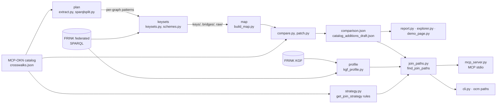

# 08 · Architecture (for contributors)

## Data flow



## Modules

| Module | Role | Network |
|---|---|---|
| `config.py` | Paths and service addresses; every setting can be overridden by environment variable | no |
| `common.py` | SPARQL client (POST, CSV results, retries only on 429/502/503/504, never raises), JSON and gzip helpers, request meter | yes (client) |
| `sparqlsplit.py` | Minimal SPARQL reader: finds `GRAPH` blocks, variables and top-level items | no |
| `extract.py` | Turns catalog queries into per-graph **endpoint patterns** and **connector patterns** | no |
| `schemes.py` | Identifier rules: recognise and standardise MONDO, DOID, HP, Orphanet, OMIM, EFO, SNOMED CT, UMLS, MeSH, Entrez, Ensembl, HGNC, UniProt, GO, Reactome, CAS, ChEBI, ChEMBL, DrugBank, PubChem CID, InChIKey, NCBITaxon, UBERON, CL, dbSNP, ZIP5, county/state FIPS, NAICS, S2 cells, and other OBO ontologies; name normalisation for name-only joins | no |
| `keysets.py` | COUNT then DISTINCT download per pattern, under a cap; resumable; keeps raw values; `recanonicalize` | yes |
| `kgf_profile.py` | KGF index and summaries; okn-void versions | yes |
| `build_map.py` | Per-graph identifier sets; pairwise overlaps; reach through connectors | no |
| `compare.py` | Labels connections against the catalog; marks crosswalks reproduced / not found / awaiting / not parsed | no |
| `patch.py` | Draft catalog entries in MCP-OKN's format | no |
| `strategy.py` | MCP-OKN's `get_join_strategy` rules, offline | no |
| `join_paths.py` | `ConnectionMap`: `find_join_paths`, `connections_of`, evidence queries, two-hop routes, `run_live` | only `--live` |
| `mcp_server.py` | JSON-RPC 2.0 over stdio; `initialize`, `tools/list`, `tools/call`, `ping` | no |
| `report.py`, `explorer.py`, `demo_page.py` | Self-contained HTML pages (no external files or scripts) | no |
| `verify.py` | Live spot checks of sampled identifiers and their names | yes |
| `diff.py` | Changes between two runs | no |
| `kgf_hash.py` | XXH64 (seed 0), KGF's key-set hash | no |
| `cli.py` | The `ocm` command | — |

## Design rules

- **Read-only.** Only `SELECT` queries and `GET` requests are sent.
- **Standard library only.** The tool installs anywhere, including locked-down machines and MCP-OKN's own environment.
- **Never claim a non-join without evidence.** When identifiers were not fully read, the verdict is "not measured".
- **Reproducible.** Each run keeps the exact catalog it used (`catalog_snapshot.json`), the releases measured (`profile.json`), and the raw values (`raw/`).
- **Patterns come from verified crosswalks.** The tool does not write per-graph queries of its own.

## Adding an identifier type

1. Add the pattern to `_SCHEMES` in `schemes.py`. Add hint words, so catalog keys mentioning it are recognised.
2. Add test cases to `tests/test_schemes.py`, including at least one look-alike that must be **rejected**.
3. Run `ocm recanon --label <run>` to re-apply all rules to saved raw values, with no new download.

## Tests

```bash
python -m unittest discover -s tests -v
```

The tests are offline: identifier rules, strategy rules, an end-to-end `find_join_paths` on the sample run, the MCP handshake, and the CLI.
